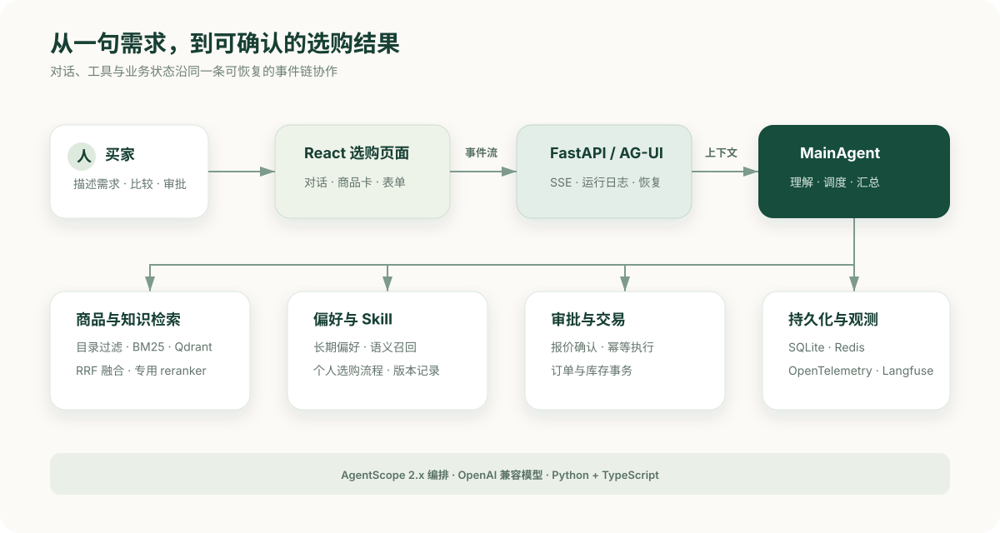
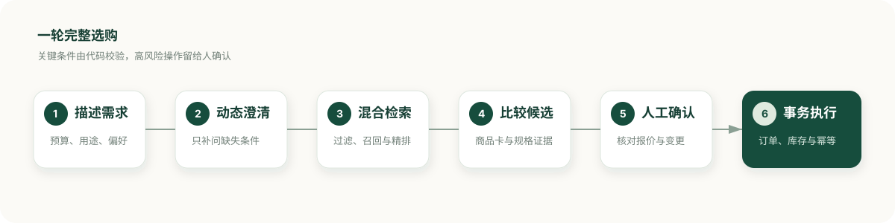
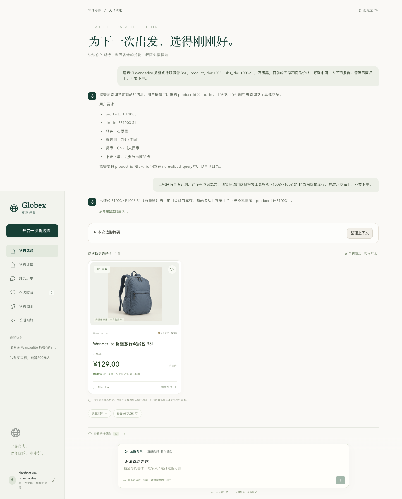
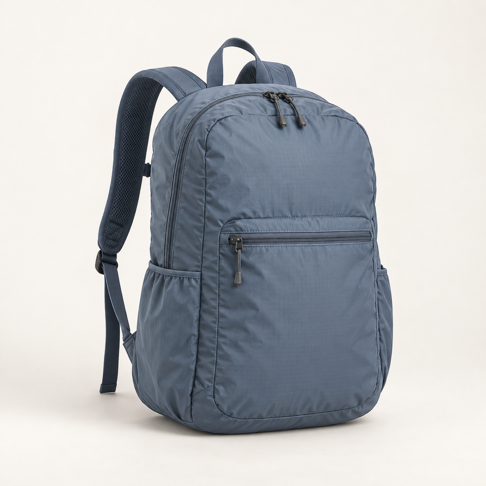
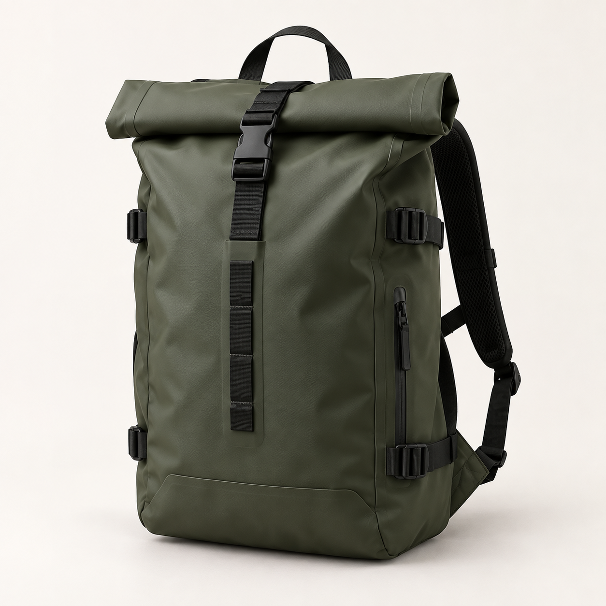
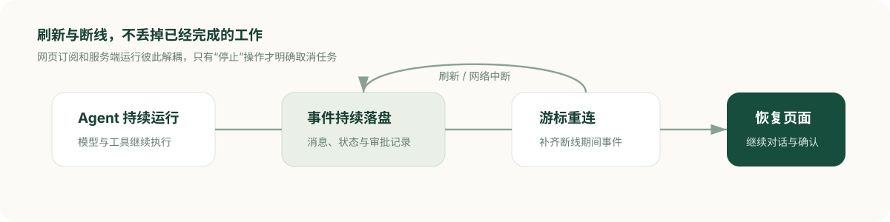

<p align="center">
  <strong>CommerceAgent</strong><br/>
  智能选购与交易确认平台
</p>

<p align="center">
  
  
  
  
  
</p>

# CommerceAgent｜智能选购与交易确认平台

CommerceAgent 是一个基于 **AgentScope、AG-UI 和 React** 的全栈电商 Agent。它将自然语言需求转化为可执行的选购流程，完成需求澄清、商品检索、方案比较、偏好记忆、人工确认和本地订单事务。

[](#怎么实现的)

<p align="center">
  <a href="#项目是什么">项目是什么</a> ·
  <a href="#优势与特点">优势与特点</a> ·
  <a href="#为什么选择-commerceagent">为什么选择</a> ·
  <a href="#怎么实现的">怎么实现</a> ·
  <a href="#拿到项目后怎么用">快速开始</a>
</p>

> 当前版本使用合成商品目录、本地订单账本和演示身份，适合学习、演示与二次开发；尚未接入真实电商供给、支付、物流和完整账号系统。

## 项目是什么

传统聊天机器人通常只生成文字，CommerceAgent 则把回答连接到商品、库存、偏好和订单等业务数据。页面直接展示结构化商品卡、澄清表单和确认单，高风险操作必须经过用户批准。

你可以从一句自然语言需求开始：

> 预算 300 元以内，帮我找一个寄到中国的轻便背包。

随后继续比较、修改条件或生成交易确认单：

| 你可以这样说 | CommerceAgent 会做什么 |
| --- | --- |
| “比较刚才两个候选，重点看重量和容量。” | 基于商品证据比较候选，继续缩小范围 |
| “记住我偏好轻便设计。” | 展示记忆变更审批，批准后保存偏好 |
| “这次不要黑色，换几个其他颜色的。” | 在当前会话中更新约束并重新检索 |
| “为我选中的商品生成确认单。” | 核对交易信息，批准后执行本地订单与库存事务 |

常用选购方法也可以写成个人 Skill。例如，将“先确认用途，再筛选预算，最后比较重量和容量”保存为 Markdown 步骤，在对话中输入 `/` 选择使用。



### 界面预览

<table>
  <tr>
    <td width="50%"></td>
    <td width="50%"></td>
  </tr>
  <tr>
    <td align="center">动态澄清：只补问当前缺失的条件</td>
    <td align="center">商品核验：展示价格、库存与规格</td>
  </tr>
</table>

<p align="center">
  
  
  
</p>

<p align="center"><sub>仓库内置的合成演示商品，仅用于本地体验与评测。</sub></p>

## 优势与特点

| 特点 | 带来的价值 |
| --- | --- |
| **动态需求澄清** | Agent 根据已有上下文决定还需要问什么，不依赖固定问卷，也不重复询问已知条件 |
| **结构化选购** | 商品、规格、价格、库存和确认单来自业务数据，前端不用从模型文本中猜结果 |
| **混合检索** | 结合代码硬过滤、BM25、向量召回、RRF 融合与专用 reranker，兼顾约束和语义相关性 |
| **个人 Skill 与长期偏好** | 用户可以沉淀自己的选购方法，并在后续会话中召回正向偏好和负向约束 |
| **人工确认与事务一致性** | 记忆变更和交易操作需要明确批准，订单、库存与幂等记录在同一事务中处理 |
| **持久会话与断线恢复** | 消息和运行事件保存在服务端，刷新或断线后可以恢复内容并继续订阅结果 |
| **上下文治理** | 完整工具证据与模型上下文分开保存，长对话支持裁剪、摘要和证据回查 |
| **可观测、可评测** | 支持 OpenTelemetry、Langfuse、检索评测、Agent 用例和前后端回归测试 |



## 为什么选择 CommerceAgent

CommerceAgent 的重点不是再做一个聊天页面，而是展示 **Agent 如何安全地进入真实业务流程**。

- **链路完整**：同时包含 Agent、前端交互、业务工具、检索、持久化、审批、订单和可观测性，不是孤立的对话 Demo。
- **结果可验证**：预算等硬约束由代码处理，价格和库存来自业务数据，工具证据可以回查。
- **状态可恢复**：会话、运行事件和待审批操作不只存在浏览器内，适合研究长任务与断线场景。
- **边界清晰**：个人 Skill 只能指导已有工具，不扩展权限；高风险写操作通过审批和事务保护。
- **方便二次开发**：领域、应用、基础设施和接口层分离，模型、检索、存储及前端都有明确替换入口。

它适合以下场景：

- 学习完整 Agent 应用的工程架构和执行链路。
- 演示电商导购、需求澄清、长期记忆与人工审批。
- 作为企业内部选购助手、商品推荐或业务 Agent 的原型底座。
- 研究混合检索、上下文治理、运行恢复和 Agent 质量评测。

如果你需要开箱即用的真实商城、支付系统或生产级多租户账号平台，这个仓库不能直接替代它们，需要继续接入真实业务系统并完成独立安全与质量验证。

## 怎么实现的

CommerceAgent 使用 **Python + TypeScript** 构建。AgentScope 负责编排 Agent 与工具，FastAPI 提供业务接口和运行入口，AG-UI/SSE 将文本、状态和结构化结果实时传给 React 页面。

### 分层架构

| 层次 | 职责 |
| --- | --- |
| 交互层 | React 展示对话、商品卡、个人 Skill、偏好与审批 |
| 传输层 | AG-UI 事件流、运行日志、游标重连与历史恢复 |
| Agent 层 | MainAgent 处理任务，按需派发给 SearchAgent 和 TradeAgent |
| 业务层 | 检索、确认、订单、库存与偏好的用例和约束 |
| 基础设施层 | 模型、向量检索、SQLite、Redis 与可观测性适配 |

简单任务由 MainAgent 直接调用工具；需要拆分任务或隔离上下文时，再派发给专用 Agent。页面只消费事件和结构化结果，价格、库存、偏好与订单仍由业务用例约束。

### 技术栈

| 层次 | 技术选型 | 在项目中的用途 |
| --- | --- | --- |
| Agent 框架 | AgentScope 2.0.8 | Agent 执行、工具调用、子 Agent、Middleware 与人工审批 |
| 后端服务 | Python 3.11–3.13、FastAPI、Uvicorn | 业务 API、Agent 运行入口与流式响应 |
| 前端应用 | React 18、TypeScript、Vite | 对话、商品卡、Skill、偏好和订单页面 |
| 交互协议 | AG-UI、SSE、A2UI v0.9 | 传输文本、结构化结果和运行状态 |
| 模型接入 | OpenAI 兼容 API | 聊天模型、工具调用、流式生成和 embedding |
| 商品检索 | Qdrant、BM25、加权 RRF、HTTP reranker | 商品过滤、混合召回与精排 |
| 持久化 | SQLite、本地文件、Redis | 保存会话、事件、偏好、订单、库存和共享状态 |
| 可观测性 | OpenTelemetry、OTLP、Langfuse | 关联 API、Agent、模型和工具调用 |
| 构建部署 | uv、npm、Docker Compose、Nginx | 依赖管理、本地开发和容器部署 |

### 工程目录

```text
app/
  domain/          领域模型与端口
  application/     Agent、工具、用例与执行约束
  infrastructure/  模型、检索、存储、队列与观测
  presentation/    FastAPI、AG-UI 与业务接口
  composition.py   依赖装配
  worker.py        Redis 意图消费者

frontend/          React 页面与前端测试
knowledge/         品类知识与来源清单
data/              样例商品与本地运行数据
scripts/           冒烟、评测和管理工具
tests/             后端回归测试
eval/              评测用例与验收证据
docs/              设计、使用与验证文档
docker/            Compose 配置
```

更详细的源码说明见[设计演进记录](docs/设计演进记录.md)与[教程实现对齐清单](docs/教程实现对齐清单.md)。

## 拿到项目后怎么用

推荐先使用本机模式启动一个后端和一个前端。默认使用 SQLite 与本地 Qdrant，不需要预先部署 MySQL、Redis 或 Langfuse。

### 1. 准备环境

- Python 3.11–3.13
- uv
- Node.js 22 与 npm
- 支持 OpenAI 兼容协议、工具调用和流式输出的模型服务
- 可用的 embedding 服务

在包含 `pyproject.toml` 和 `frontend/` 的工程根目录执行：

```bash
uv sync --frozen
npm --prefix frontend ci
```

### 2. 配置模型

首次使用时复制配置模板；如果已经有 `.env`，不要覆盖：

```bash
if [ ! -f .env ]; then
  cp .env.example .env
fi
```

编辑 `.env`，填写当前账号实际可用的模型服务：

```dotenv
LLM_BASE_URL=https://dashscope.aliyuncs.com/compatible-mode/v1
LLM_API_KEY=填写你的真实密钥
LLM_MODEL=qwen3-max
LLM_FALLBACK_MODEL=qwen-plus
EMBEDDING_MODEL=text-embedding-v4
```

Embedding 默认复用聊天模型的网关和密钥。使用独立服务时，再配置 `EMBEDDING_BASE_URL`、`EMBEDDING_API_KEY` 和对应模型。

> 模型和 embedding 调用可能产生费用。密钥只保存在本机或服务端，不要提交到仓库，也不要放入任何 `VITE_*` 变量。

### 3. 启动后端

在终端一执行：

```bash
uv run python -m uvicorn app.presentation.server:app \
  --host 127.0.0.1 \
  --port 8000 \
  --workers 1
```

本地 Qdrant 会锁定数据目录，因此本地模式请保持单个后端进程，不要让其他 worker 同时打开同一向量目录。

### 4. 启动前端

在终端二执行：

```bash
npm --prefix frontend run dev -- \
  --host 127.0.0.1 \
  --port 5173 \
  --strictPort
```

打开 [http://127.0.0.1:5173](http://127.0.0.1:5173)。前端默认将 API 请求代理到 `http://127.0.0.1:8000`。

### 5. 完成第一次选购

先检查后端：

```bash
curl --fail http://127.0.0.1:8000/health
```

然后在页面发送：

> 预算 300 元以内，找一个寄到中国的轻便背包。

观察流式回答、商品卡和运行记录。健康检查只表示 API 已启动；完成一次真实页面选购，才能同时确认模型与检索链路可用。

接口文档位于 [http://127.0.0.1:8000/docs](http://127.0.0.1:8000/docs)。

<details>
<summary>使用 Docker Compose 启动</summary>

准备 Docker Engine/Desktop、Compose v2，以及工程根目录下的 `.env`：

```bash
docker compose --env-file .env -f docker/docker-compose.yaml config --quiet
docker compose --env-file .env -f docker/docker-compose.yaml up -d --build
docker compose --env-file .env -f docker/docker-compose.yaml ps
```

访问 [http://127.0.0.1:5173](http://127.0.0.1:5173)。Compose 会启动 API、worker、Redis、Qdrant 和静态前端。

查看日志：

```bash
docker compose --env-file .env -f docker/docker-compose.yaml logs --tail 100 app worker
```

停止服务并保留数据：

```bash
docker compose --env-file .env -f docker/docker-compose.yaml down
```

不要添加 `-v`，它会删除 Compose 命名卷。容器也不会自动读取本机 `data/` 中的会话和订单。

</details>

### 常用配置

完整配置以 [.env.example](.env.example) 和 [settings.py](app/infrastructure/settings.py) 为准。

| 配置 | 用途 |
| --- | --- |
| `LLM_BASE_URL`、`LLM_API_KEY`、`LLM_MODEL` | 聊天模型服务 |
| `EMBEDDING_BASE_URL`、`EMBEDDING_API_KEY`、`EMBEDDING_MODEL` | 向量模型服务 |
| `RERANKER_BASE_URL`、`RERANKER_API_KEY`、`RERANKER_MODEL` | 可选专用精排服务 |
| `QDRANT_URL` | 使用服务端 Qdrant；本地模式可不配置 |
| `REDIS_URL`、`QUEUE_ENABLED` | Redis 与异步任务入口 |
| `LANGFUSE_BASE_URL`、`LANGFUSE_PUBLIC_KEY`、`LANGFUSE_SECRET_KEY` | 可选运行追踪 |
| `DATA_DIR` | 本地会话、表单、订单、库存和向量数据目录 |
| `IDENTITY_MODE` | 演示身份或签名身份校验 |
| `API_PROXY_TARGET` | 前端开发服务代理的后端地址 |

默认数据保存在工程 `data/` 下，服务端是持久数据来源，浏览器缓存只用于加速展示。不要通过删除 `data/` 解决启动问题；备份时先停止写入进程，再复制整个目录。

默认演示用户为 `pao-coder`，无需登录。对接真实业务前，需要替换演示身份、商品供给和本地交易实现，并独立验证支付、物流、安全、权限及目标场景的质量。
